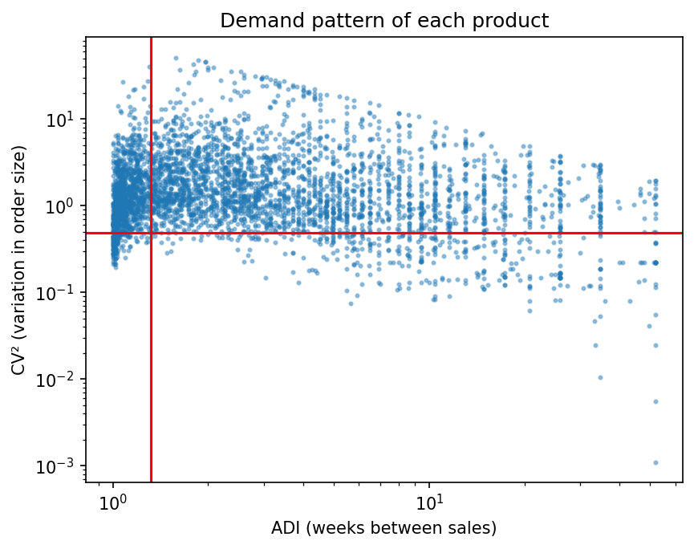
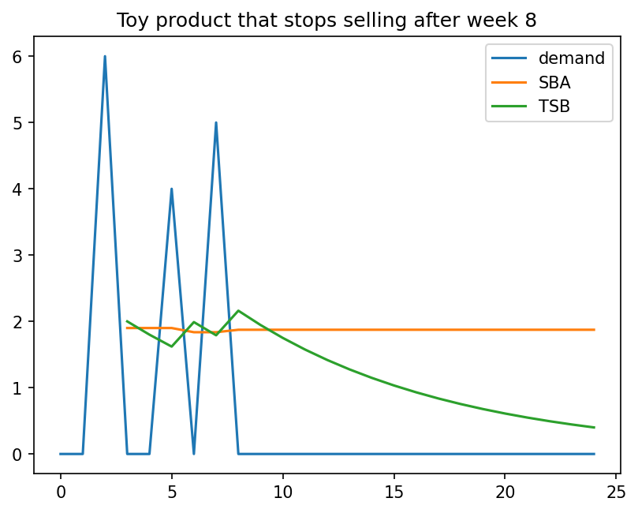
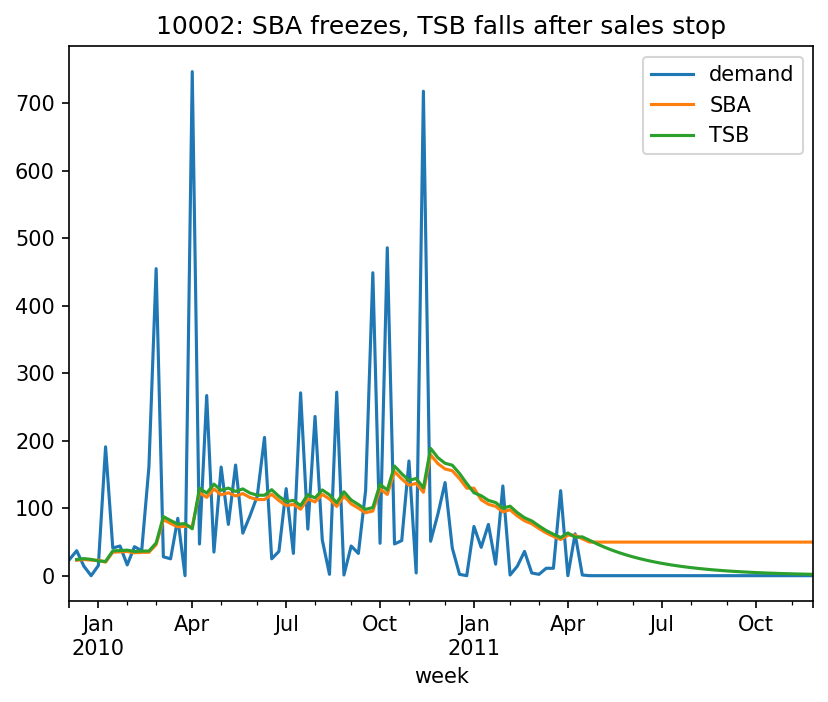

# Demand & Stock Planner for a Wholesale Distributor

Forecasting and stock planning for thousands of products whose demand is irregular, built on real wholesale transaction data, with a PostgreSQL database that mirrors how an ERP stores sales, stock and supplier data.

## 1. The problem

A distributor holds thousands of product lines, and most of them do not sell every week. Some sell once a month, some sell in large one-off orders, and some quietly stop selling altogether. Standard forecasting methods assume steady demand, so on these products they either over-order (money tied up in stock nobody buys) or under-order (customers turned away). This project measures how much that matters on real data and tests methods designed for irregular demand.

## 2. Key results

- **Only 3.1% of products had steady demand.** Of 4,183 products with enough history, 60.2% were *lumpy* (sell in some weeks, in very variable amounts), 26.6% *erratic* and 10.0% *intermittent*. Methods that assume steady demand fit only a small minority of the catalogue.
- **SBA did worse than forecasting zero on irregular products.** On lumpy products its average error was 19.15 units per week against 9.51 for a forecast of zero, because its forecast freezes when a product stops selling.
- **TSB fixed the end-of-life problem.** By updating the probability of a sale every week, its forecast falls towards zero for discontinued products. With a faster reaction setting (α = β = 0.2) it matched or beat a moving-average baseline on error, with less bias.
- **Judged by stock outcomes, SBA held 24% more stock and served fewer customers.** In a 26-week warehouse simulation on lumpy products, SBA held 355,716 units on average against 287,453 for TSB, yet met 82.6% of demand against 87.4%. The extra stock sat on discontinued products while live products ran short.



## 3. Data

- **Source:** [Online Retail II](https://archive.ics.uci.edu/dataset/502/online+retail+ii), UCI Machine Learning Repository, licensed CC BY 4.0.
- **What it is:** 1,067,371 transactions from a UK online retailer, 1 December 2009 to 9 December 2011. According to the dataset description, many of its customers are wholesalers.
- **One row = one product line on one invoice.** Columns: Invoice, StockCode, Description, Quantity, InvoiceDate, Price, Customer ID, Country.
- The data is not included in this repository. Download it from the link above into `data/`.

## 4. Data notes and cleaning

Like most business-system exports, the file records every event that moves stock or money, not only customer demand. Investigating the data before cleaning it found:

- **Cancellations** are separate rows with negative quantities and an invoice starting with `C` (19,494 rows). They were **kept**, so that they subtract from sales when demand is totalled.
- **Stock adjustments:** 3,457 negative-quantity rows were not cancellations. All had a price of 0 and no customer, with descriptions such as "damages", "missing", "smashed" and "?". These are warehouse write-offs, not demand.
- **Bad-debt adjustments:** invoices starting with `A` (6 rows) with stock code `B` and amounts up to −£53,594.
- **Non-product codes:** postage (`POST`, `DOT`, `C2`), discounts (`D`), manual corrections (`M` and `m`), fees (`BANK CHARGES`, `AMAZONFEE`), test entries (`TEST001`, `TEST002`) and gift vouchers (`gift_0001_…`). Codes that did not match the usual pattern but were real products (`DCGS…`, `PADS`) were kept. Removing by pattern alone would have deleted them, so non-products were removed using an explicit, reviewed list.
- **Mixed types:** invoice numbers, stock codes and descriptions mixed numbers and text, so all ID and text columns were converted to text on purpose.

| Cleaning rule | Rows removed |
|---|---|
| Exact duplicate rows (assumed export errors) | 34,335 |
| Bad-debt adjustments (`A` invoices) | 6 |
| Non-product codes | 5,791 |
| Zero or negative price (stock adjustments, system entries) | 5,964 |
| **Total** | **46,096 (4.3%)** |

Result: 1,021,275 rows. Checks after cleaning confirmed no zero or negative prices remained, the only negative quantities were cancellations, and no blank descriptions remained.

**Weekly demand.** Sales were totalled per product per week (4,719 products, 104 weeks). Weeks with no sales were added back as zeros, because a week with no sales is information that irregular-demand methods depend on. Each product starts at its first week of sales, so new products are not padded with false zeros. The incomplete first and last weeks were dropped. Weeks where cancellations outweighed sales (2,122 product-weeks) were set to zero. Before removing closure weeks, 54.0% of product-weeks had zero sales. Weeks where the whole business was closed (Christmas) were then removed, because those zeros mean "shut", not "no demand".

## 5. Method

**Classification.** Each product was classified by two measures, using the commonly used cut-offs of Syntetos, Boylan and Croston (2005):
- **ADI**, the average number of weeks between sales (cut-off 1.32);
- **CV²**, how much order size varies when a sale happens (cut-off 0.49).

Products with under 26 weeks of history were labelled "too new".

**Forecasting.** Three methods, the last two written from scratch:
- **MA8:** the average of the last 8 weeks (baseline).
- **SBA:** Croston's method with the Syntetos–Boylan correction. It tracks typical order size and typical gap between sales, updating only when a sale happens.
- **TSB:** tracks typical order size and the probability of a sale, updating that probability every week, so the forecast falls for products that stop selling.

Both implementations were checked against hand calculations on a test series.



**Evaluation.** The final 26 weeks were held out. Forecasts were produced week by week using only earlier data (rolling forecasts). Products were re-classified using training weeks only, so the evaluation did not see the test period.

Average error (MAE, units per week) and bias (positive = over-forecasting), test period:

| Group | MA8 | SBA | TSB | TSB α=0.2 | Forecast of zero |
|---|---|---|---|---|---|
| Lumpy | 7.93 | 19.15 | 8.83 | 7.96 | 9.51 |
| Intermittent | 2.30 | 5.76 | 2.28 | 2.26 | 2.56 |
| Erratic | 34.79 | 35.32 | 34.81 | 34.26 | 49.04 |
| Smooth | 68.59 | 67.65 | 67.79 | 67.83 | 139.24 |

| Bias | MA8 | SBA | TSB | TSB α=0.2 |
|---|---|---|---|---|
| Lumpy | −1.96 | +7.33 | −2.20 | −1.90 |
| Intermittent | −0.22 | +2.60 | −0.61 | −0.37 |

Two findings from these tables:
- The moving average was only 10% better than a forecast of zero on intermittent products (2.30 against 2.56), and 17% better on lumpy products. Average error barely separates useful forecasts from useless ones on this kind of demand, so the methods were also judged on stock outcomes.
- Making the methods react faster helped TSB (lumpy error 8.83 → 7.96) but barely helped SBA (19.15 → 18.72). This separates the two problems: TSB was too slow, while SBA's forecasts freeze on dead products, which reacting faster cannot fix.



**Stock simulation.** Each method drove a simple weekly reorder policy over the test period. Stock was topped up to *forecast × (lead time + 1) + safety stock*, with a 2-week lead time, safety stock = 1.65 × forecast error × √(lead time + 1), and lost sales when stock ran out.

| Lumpy products | Fill rate | Average stock (units) |
|---|---|---|
| MA8 | 88.0% | 292,010 |
| SBA | 82.6% | 355,716 |
| TSB | 84.1% | 287,738 |
| TSB α=0.2 | 87.4% | 287,453 |

| Intermittent products | Fill rate | Average stock (units) |
|---|---|---|
| MA8 | 82.5% | 6,579 |
| SBA | 73.4% | 10,541 |
| TSB | 77.7% | 6,155 |
| TSB α=0.2 | 81.8% | 6,423 |

TSB α=0.2 and MA8 sit at a trade-off: MA8 meets slightly more demand, and TSB α=0.2 holds slightly less stock. A fair comparison would set each method's safety factor to reach the same fill rate and compare the stock each needs.

## 6. Database

`sql/schema.sql` and `load_database.py` load the data into PostgreSQL as linked tables, the way an ERP stores them: products (4,740), sites, suppliers, product–supplier links, sales (1,021,275), forecasts (4,719) and stock on hand (13,446 product–site rows). Primary keys, foreign keys and check constraints reject bad data at load time, for example a sale for an unknown product or negative stock. `sql/queries.sql` answers operational questions with SQL joins, such as "which products at which site are below their reorder level, and which supplier do we call?"

**Real data:** products and sales. **Simulated** (clearly flagged in every table): sites, suppliers, lead times and stock levels, because the public dataset contains none of these.

## 7. Limitations

- The faster reaction setting (α = 0.2) was explored using the test period, which risks fitting to it. A final version should choose it on a validation slice of the training period.
- The 2-week lead time and all site, supplier and stock data are assumed or simulated.
- The products are gift-ware, not engineering parts. The method carries over, but the mix of demand patterns would come from the business's own data.
- The test period includes the pre-Christmas peak, which favours fast-reacting methods. Most methods under-forecast in that period.
- The safety-stock formula assumes normally distributed errors. Lumpy products reached 82–88% fill rates against a nominal 95% target, which shows that assumption does not hold for lumpy demand.
- Exact duplicate rows were assumed to be export errors. With access to the source system this would be confirmed with the people who use it.

## 8. How to run it

```bash
pip install -r requirements.txt
```

1. Download Online Retail II into `data/`.
2. Run the notebook `demand_planner.ipynb` from top to bottom. It writes `data/clean.parquet`, `data/weekly.parquet` and `data/profile.parquet`.
3. Optional: create a PostgreSQL database called `demand_planner`, then run `python load_database.py` and the queries in `sql/queries.sql`.

## 9. Next steps

- Compare methods at an equal fill rate, so the stock needed for the same service can be compared directly.
- Choose smoothing settings on a validation period rather than the test period.
- Build an end-of-life flag into reorder decisions, so products with a falling probability of sale stop being reordered automatically.
- A dashboard for non-technical staff showing each product's forecast, reorder advice and the reason behind it.